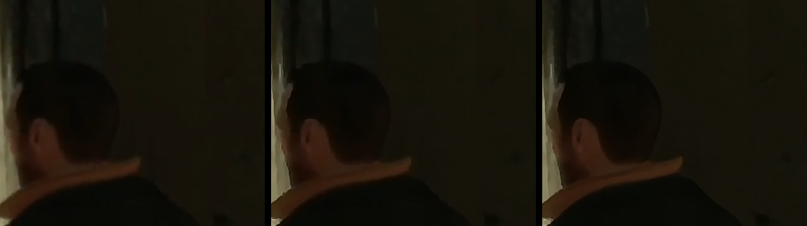

# LiteView for Twitch

**Watch Twitch while you game, without the browser eating your FPS, and with a sharper picture than the website.**

LiteView is a small Windows app: your Twitch *Following → Live* page, and one click opens the stream as
**followed channels + video + chat in one window**, like Twitch's own layout. The video plays in
[mpv](https://mpv.io) (hardware decoding, tiny CPU cost) with optional AI / shader upscaling. The chat is
LiteView's own (Twitch IRC) with **Twitch, 7TV, BetterTTV and FFZ emotes**, so no browser runs while you watch.
Everything runs on the CPU cores your game is *not* using.

**[⬇ Download the latest release](../../releases/latest)**: unzip anywhere, run `LiteView.exe`. No installer, no account other than your Twitch login.


<sub>Same paused frame of a live 720p stream shown at 1080p: Picture Off (left), Ultra (middle), Ultra + RTX (right).</sub>

## Why

A Twitch tab in Chrome with a few extensions measured **118% of a CPU thread and 3 GB of RAM** on my PC
while I played Call of Duty, and Chrome runs its graphics process **above** normal priority, on the same cores
as the game. LiteView plays the same stream with the work kept off the game's cores and below the game in
priority, and the video itself (mpv) costs **under 10% of a thread**.

| 1080p60 stream with its chat | CPU (one thread) | RAM |
|---|---|---|
| Chrome tab (3 tabs, extensions) | 118% | 3.0 GB |
| LiteView 1.0: video + Twitch web chat with 7TV | 30% | 1.4 GB |
| **LiteView 1.1: video + native chat** | **10%** | **0.35 GB** |

<sub>LiteView rows: same build, same busy channel (KaiCenat, 37K viewers), 60 s each, all of LiteView's processes
(working set). The chat itself went from 17.5% of a thread and 1.1 GB (WebView2) to 0.9% and 0.1 GB.</sub>

## Features

- **Your Following → Live page**: log in once; click any streamer to watch. Search box for any channel.
- **Followed channels column** while you watch, like Twitch's left column: who is live (avatar, name, game,
  viewers), refreshed every minute; one click switches stream. Collapse it to avatars with the arrow.
- **Native chat**: name colours, badges, Twitch + 7TV + BetterTTV + FFZ emotes (animated ones move only while
  on screen), 7TV zero-width emotes, replies, mentions of you highlighted, links, sub/raid notices, deleted
  messages, sending with `Tab` completion of emotes and @names and `↑` for your last messages. Scroll up to
  pause it. Text is drawn with grayscale anti-aliasing, smooth whatever your Windows ClearType setting is.
- **Emote picker** (smiley next to the chat input), like 7TV's: search the channel's 7TV, BetterTTV and FFZ emotes,
  your own Twitch emotes and the global sets; recently used ones on top; a click puts the emote in your message. Twitch's web chat (with 7TV) stays available: gear icon in the chat, or right-click *Chat*.
- **Video + chat in one window**: the video area stays 16:9 while you resize, so there are no black bars.
- **Picture settings** (work on **any** GPU: AMD, Intel, NVIDIA):

  | Picture | What it does | GPU cost* |
  |---|---|---|
  | Off | plain mpv | 0.6% |
  | Enhance | AMD FSR 1 upscaling + AMD CAS sharpening + debanding | 1.1% |
  | High | FSRCNNX neural upscaling + Adaptive Sharpen + debanding | 2.6% |
  | Ultra | NLMeans clean-up of compression noise, FSRCNNX 16, KrigBilateral colour, SSimDownscaler, strong Adaptive Sharpen, high-quality scaling, motion smoothing timed to your monitor | 11% |
  | + RTX (NVIDIA RTX only) | NVIDIA RTX Video does its AI clean-up first, then the upscaler above | 25% with Ultra |

  <sub>*RTX 5080, 720p stream shown at 1080p. The upscalers work windowed, maximized and fullscreen.</sub>
- **Game first**: LiteView and everything it starts (WebView2, Streamlink, mpv) run on the CPU die *without* 3D V-Cache on Ryzen X3D chips (auto-detected), at Below Normal priority, with mpv's GPU work at Below Normal GPU priority.
- **Volume, mute, quality, fullscreen** in the top bar. On the video: double-click / `F` fullscreen, `Esc` leave, mouse wheel volume, `M` mute.
- **Ad segments skipped** (Streamlink), and **HEVC/AV1 up to 1440p** used automatically when a streamer offers it.
- **GameFirst.exe** (optional): a tiny background helper that keeps **Chrome** (or Discord, Steam…) off your game's cores and below the game too.

## Install

1. Download `LiteView-for-Twitch-<version>.zip` from [Releases](../../releases/latest) and unzip it anywhere.
2. Run `LiteView.exe`, log in to Twitch once in its window. Open a stream and click *Log in with Twitch* in the
   followed-channels column (or under the chat): Twitch's own activate page opens, click *Activate* and *Authorize*.
   This lets LiteView read who you follow, list your Twitch emotes and chat as you
   (scopes `user:read:follows user:read:emotes chat:read chat:edit`).
3. Optional: GameFirst at startup: `Win+R` → `shell:startup` → right-drag `GameFirst.exe` in → *Create shortcuts here*.

Needs Windows 10/11 64-bit (the WebView2 runtime and .NET Framework 4.8 are already part of Windows).
For RTX: turn on *RTX Video Enhancement → Super Resolution* in the NVIDIA app.

## FAQ

**Why FSR 1 and not FSR 2/3/4 or DLSS?** Those rebuild frames from a game engine's motion vectors and depth.
A video stream has none, so they cannot run on video. FSR 1 is AMD's newest upscaler that works on any picture.

**Where is my login stored?** Only on your PC: the Twitch page login in the `webview` folder next to `LiteView.exe`,
and the chat / followed-channels token in `liteview.token`, encrypted for your Windows account. LiteView has no
telemetry and talks only to Twitch, the 7TV / BetterTTV / FFZ emote services, and the Chrome Web Store once
(to fetch 7TV for the web chat if Chrome does not have it). *Log out* in the chat's gear menu revokes the token.

**Known limits:** best at 100% Windows display scaling for now; the picture can only be as good as the stream
Twitch sends (most are 1080p60 at 6-8 Mbps).

## Build from source

```powershell
powershell -ExecutionPolicy Bypass -File build.ps1 -Version 1.2.0
```
Downloads the pinned Streamlink, mpv and WebView2 SDK (checked by SHA-256 / Microsoft signature), compiles both
apps with the C# compiler built into Windows, and writes `dist\LiteView-for-Twitch-1.2.0.zip`.

## Credits and licences

LiteView's own code is MIT. It bundles Streamlink, mpv, the Microsoft WebView2 SDK and shaders by AMD, igv,
an3223 and bacondither under their own licences: see [THIRD_PARTY_NOTICES.md](THIRD_PARTY_NOTICES.md).

*LiteView for Twitch is an independent project, not affiliated with or endorsed by Twitch Interactive, Inc.*
